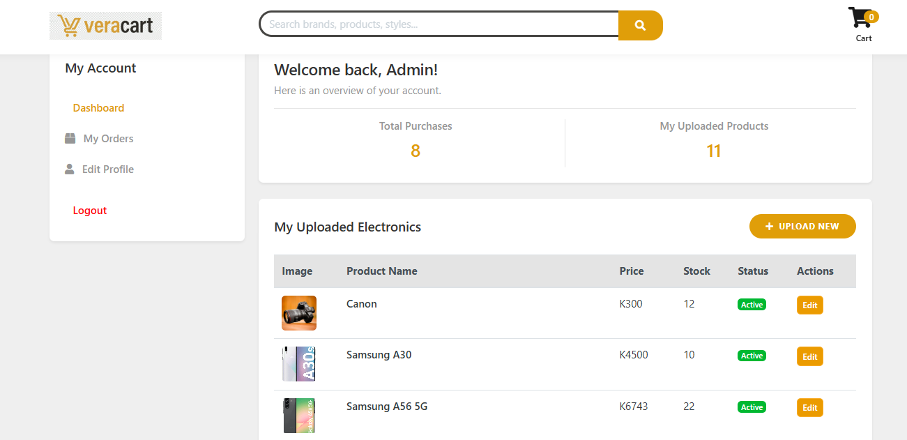
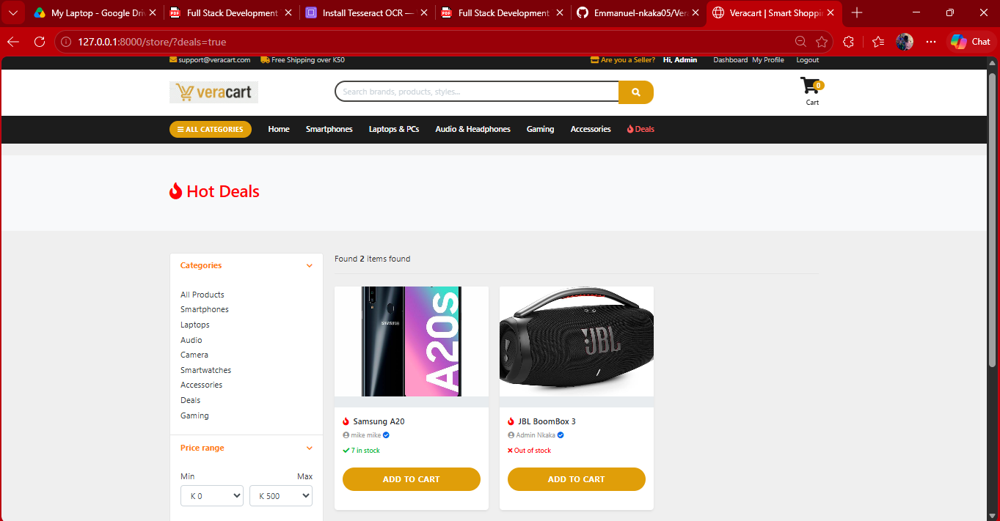

# Veracart - Django E-Commerce Platform

Veracart is a fully functional, multi-vendor e-commerce platform built with Django. It features a modern, responsive user interface, a complete shopping cart flow, seller product management, and simulated payment processing. 

This project was developed to demonstrate full-stack web development capabilities, clean database architecture, and a polished user experience.

## 🚀 Features

- **User Authentication & Roles:** Separate registration and login flows for Buyers and Sellers. Custom User Model (`Account`).
- **Product Catalog:** Dynamic product listings, categories, and search functionality.
- **Product Variations:** Support for colors and sizes (e.g., for smartphones or clothing).
- **Shopping Cart:** Session-based cart that allows adding, removing, and updating quantities.
- **Checkout & Payments:** Complete order flow with a simulated payment gateway that handles stock reduction, generates order numbers, and creates printable receipts.
- **Order Management:** Users can view their order history and print digital receipts.
- **Seller Dashboard:** Sellers can upload new products, manage stock levels, toggle availability, and feature items in "Hot Deals".
- **Reviews & Ratings:** Users who have purchased an item can leave a star rating and review.
- **Modern UI:** Built with Bootstrap, custom CSS, and FontAwesome icons.

## 🛠️ Built With

- **Backend:** Python, Django (v6.1)
- **Frontend:** HTML5, CSS3, JavaScript, Bootstrap 4
- **Database:** SQLite (Development)
- **Icons:** FontAwesome

## 📸 Screenshots

### 1. User Dashboard & Order History


### 2. Seller Dashboard & Stock Management


### 3. Hot Deals Section (Homepage)


## 💻 Getting Started

To get a local copy up and running, follow these simple steps.

### Prerequisites
Make sure you have Python installed on your machine.

### Installation

1. **Clone the repository:**
   ```bash
   git clone https://github.com/your-username/veracart.git
   cd veracart